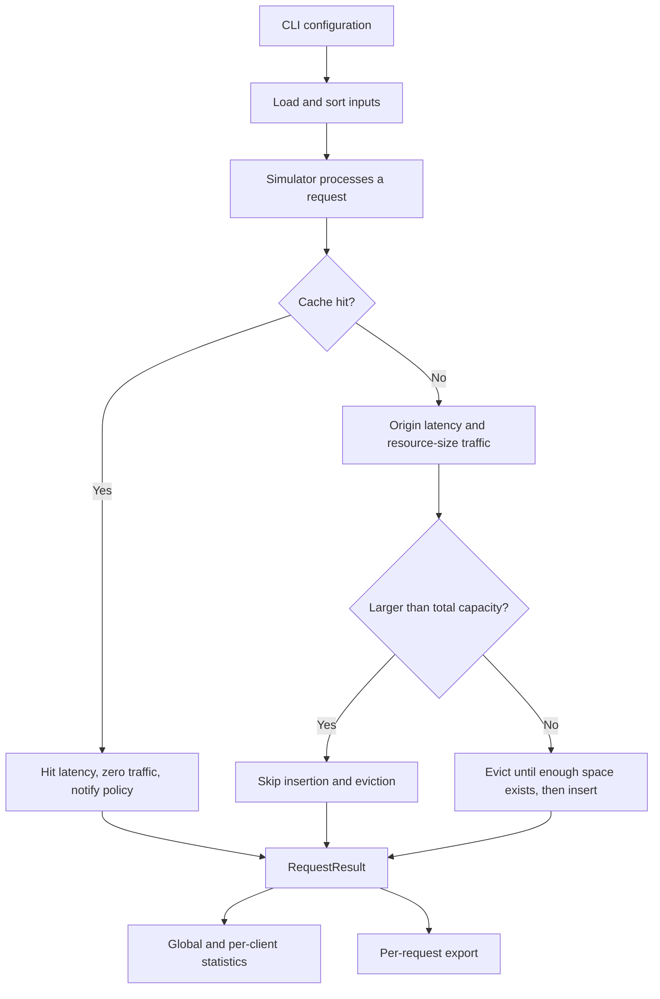

# Draft module interfaces

These contracts are proposals for contributor review. They define the scaffold's intended integration boundaries; unfinished implementations must not be reported as complete.

## Request flow



## Module contracts

| API | Input | Output and responsibilities |
|---|---|---|
| load_resources(path) | Metadata CSV | dict[full URL, Resource]; reject duplicate or invalid data |
| load_requests(path, resources) | Request CSV and metadata index | Stable UTC-ordered Request list; reject unknown resources |
| Cache(capacity_bytes, policy) | Capacity and a fresh policy | Empty storage with byte accounting and insertion order |
| Cache.contains(id) | Full URL | bool; no implicit policy updates |
| Cache.can_fit(size) | Resource size in bytes | Whether the resource fits total capacity, independently of free space |
| Cache.record_hit(resource, request, step) | A hit and its processing index | Exactly one policy.on_hit call |
| Cache.admit(resource, request, step) | Resource requested on a miss | Tuple of actual evictions; skip oversized resources without callbacks |
| Cache.remove(id) | Cached full URL | Delete, update bytes, and call on_remove; proposed KeyError if absent |
| Cache.snapshot() | None | Immutable URL tuple in insertion order |
| Simulator.process_request(request, step) | One request; step starts at 1 | RequestResult including cumulative counters |
| Simulator.run(requests) | Chronological Request list | Request results; proposed single-use instance with an explicit error on reuse |
| Statistics.record(result) | RequestResult | Aggregate metrics without changing cache or policy state |
| Statistics.summary()/per_client() | Recorded state | Global dict and per-client list[dict] |

The simulator should verify that the configuration and cache capacities agree. Each run must use fresh cache, policy, and statistics instances.

## Policy lifecycle

The abstract interface in `policies/base.py` defines:

```python
on_hit(resource: Resource, request: Request, step: int) -> None
on_insert(resource: Resource, request: Request, step: int) -> None
choose_victim(items: Mapping[str, Resource]) -> str
on_remove(resource_id: str) -> None
```

`step` is a monotonic processing index and resolves recency even when timestamps are equal. Full resource and request objects preserve size, origin latency, and client context for a future custom policy without prescribing its algorithm.

The cache owns lifecycle callbacks; the simulator must not duplicate them:

1. On a hit, call `record_hit` and then `on_hit`, without reinserting.
2. On an admissible miss, repeatedly select a victim, remove it, update byte accounting, and call `on_remove`. After sufficient space exists, insert the new resource, update bytes, and call `on_insert` once.
3. On an oversized miss, skip insertion, eviction, and policy callbacks.

Supply a read-only view, such as `MappingProxyType`, to `choose_victim`. The returned identifier must exist in the current nonempty cache. Invalid victims must fail explicitly instead of causing an eviction loop. Reject duplicate admissions of an existing item to prevent double-counting capacity.

FIFO records insertion order and ignores hits. LRU updates its last-access step on insertion and hit. LFU starts at frequency 1, increments on hits, updates last-access step, chooses the minimum `(frequency, last_access_step)`, and clears metadata on removal. Custom-policy rules, tie-breaking, complexity, and any additional callbacks must be documented before integration.

## Result and export schema

`RequestResult` contains `step`, `request`, `size_bytes`, `hit`, `response_time_ms`, `origin_traffic_bytes`, `evicted_resources`, `cache_contents_oldest_first`, `cache_used_bytes`, `cumulative_origin_bytes`, and `cumulative_hits`.

The planned request CSV retains reference fields and adds diagnostic fields:

```text
step,resource_id,client_id,result,evicted,cache_contents_oldest_first,cache_used_KiB,response_ms,cumulative_origin_bytes,cumulative_hits,timestamp,size_bytes,origin_traffic_bytes,cache_used_bytes
```

Use HIT/MISS for `result`, `-` for no evictions, and comma-separated identifiers for lists, escaped through `csv.writer`. General output uses full URLs; the reference comparator maps them to A-E. Compute `cache_used_KiB` as bytes divided by 1024 without truncation. Do not round internal numeric values prematurely.

Proposed summary keys are `request_count`, `hits`, `misses`, `hit_ratio`, `byte_hit_ratio`, `average_response_time_ms`, and `origin_traffic_bytes`. Per-client records add `client_id`. Ratios use 0-1 internally. Coordinate schema changes with metric and visualization contributors.

Each run should export `requests.csv`, `summary.json`, `per_client.csv`, and `config.json`. Configuration should identify the policy, capacity in bytes, hit latency, input paths and SHA256 hashes, request count, workload, code version when available, and random seed when applicable. Separate nondeterministic metadata such as run time from reproducibility comparisons of numerical results.
