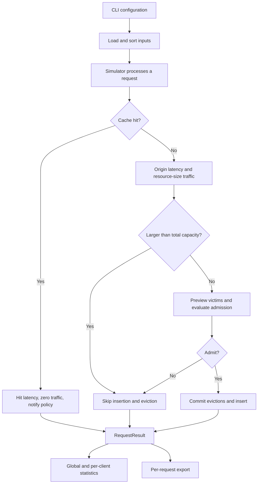

# Module interfaces

These contracts describe the integrated implementation. The admission extensions follow D's delivered Custom prototype; contributor review and team-wide sign-off are still pending.

## Request flow



## Module contracts

| API | Input | Output and responsibilities |
|---|---|---|
| load_resources(path) | Metadata CSV | dict[full URL, Resource]; reject duplicate or invalid data |
| load_requests(path, resources) | Request CSV and metadata index | Stable UTC-ordered Request list; reject unknown resources |
| Cache(capacity_bytes, policy) | Capacity and a fresh policy | Empty storage with byte accounting and insertion order |
| Cache.contains(id) | Full URL | bool; no implicit policy updates |
| Cache.can_fit(size) | Resource size in bytes | Whether the resource fits total capacity, independently of free space |
| Cache.record_hit(resource, request, step) | A hit and its processing index | Exactly one policy.on_hit call |
| Cache.admit(resource, request, step) | Resource requested on a miss | Tuple of actual evictions; skip oversized resources without callbacks |
| Cache.remove(id) | Cached full URL | Delete, update bytes, and call on_remove; KeyError if absent |
| Cache.snapshot() | None | Immutable URL tuple in insertion order |
| Simulator.process_request(request, step) | One request; step starts at 1 | RequestResult including cumulative counters |
| Simulator.run(requests) | Chronological Request list | Request results; single-use run with an explicit error on reuse |
| Statistics.record(result) | RequestResult | Aggregate metrics without changing cache or policy state |
| Statistics.summary()/per_client() | Recorded state | Global dict and per-client list[dict] |

The simulator should verify that the configuration and cache capacities agree. Each run must use fresh cache, policy, and statistics instances.

## Policy lifecycle

The interface in `policies/base.py` retains four abstract methods and adds two default hooks:

```python
on_request(resource: Resource, request: Request, step: int) -> None  # Default: no-op
on_hit(resource: Resource, request: Request, step: int) -> None
on_insert(resource: Resource, request: Request, step: int) -> None
choose_victim(items: Mapping[str, Resource]) -> str
on_remove(resource_id: str) -> None
should_admit(resource: Resource, items: Mapping[str, Resource], victims: tuple[str, ...]) -> bool  # Default: True
```

`step` is a monotonic processing index and resolves recency even when timestamps are equal. Full resource and request objects provide size, origin latency, and client context to replacement policies.

The simulator calls `on_request` once for **every** request before hit/miss handling, including oversized and bypassed requests. Cache owns the other lifecycle callbacks:

1. On a hit, call `record_hit` then `on_hit`, without reinserting.
2. On a fitting miss, plan the entire victim batch using a temporary insertion-ordered copy and read-only views. `choose_victim` must inspect the supplied candidate subset and must not mutate policy state during preview.
3. Call `should_admit` with the original read-only cache items and planned victim tuple. False returns without deletion or insertion. Standard policies always return True; Custom may bypass.
4. On admission, remove the planned victims in order, update bytes, and call `on_remove` for each. Then insert, update bytes, and call `on_insert` exactly once. Custom insertion scoring therefore sees post-eviction inflation.
5. On an oversized miss, skip planning, admission, and removal/insertion callbacks. The earlier `on_request` observation still occurs.

An invalid victim must fail explicitly before any planned deletion. Duplicate admission fails instead of double-counting bytes. Read-only views prevent storage mutation by the policy. This separates rejection planning from eviction commits; it is not a rollback mechanism for arbitrary exceptions raised by a broken policy callback.

FIFO records insertion order and ignores hits. LRU updates its last-access step on insertion and hit. LFU starts at frequency 1, increments on hits, updates last-access step, chooses the minimum `(frequency, last_access_step)`, and clears metadata on removal. Custom counts all requests persistently, supports bypass, and updates stored priorities and inflation as specified in [CUSTOM_POLICY.md](CUSTOM_POLICY.md).

## Result and export schema

`RequestResult` contains `step`, `request`, `size_bytes`, `hit`, `response_time_ms`, `origin_traffic_bytes`, `evicted_resources`, `cache_contents_oldest_first`, `cache_used_bytes`, `cumulative_origin_bytes`, and `cumulative_hits`.

The request CSV retains reference fields and adds diagnostic fields:

```text
step,resource_id,client_id,result,evicted,cache_contents_oldest_first,cache_used_KiB,response_ms,cumulative_origin_bytes,cumulative_hits,timestamp,size_bytes,origin_traffic_bytes,cache_used_bytes
```

Use HIT/MISS for `result`, `-` for no evictions, and comma-separated identifiers for lists, escaped through `csv.writer`. General output uses full URLs; the reference comparator maps them to A-E. Compute `cache_used_KiB` as bytes divided by 1024 without truncation. Do not round internal numeric values prematurely.

Summary keys include `request_count`, `hits`, `misses`, `hit_ratio`, `byte_hit_ratio`, `average_response_time_ms`, and `origin_traffic_bytes`. Per-client records add `client_id`. Ratios use 0-1 internally. Coordinate schema changes with metric and visualization contributors.

Each single run exports `requests.csv`, `summary.json`, `per_client.csv`, and `config.json`. Configuration should identify the policy, capacity in bytes, hit latency, input paths and SHA256 hashes, request count, source hashes. Batch configuration also records workload, random seeds, Python version, and exact generated trace hashes. Separate nondeterministic metadata such as run time from reproducibility comparisons of numerical results.
