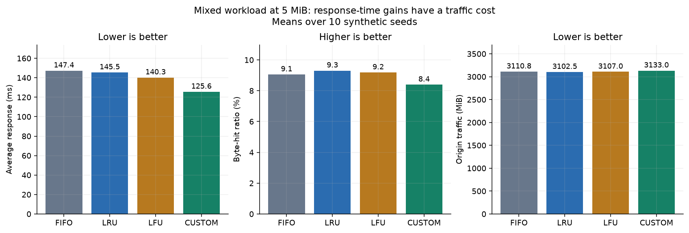
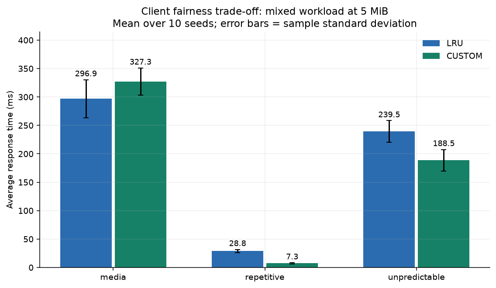
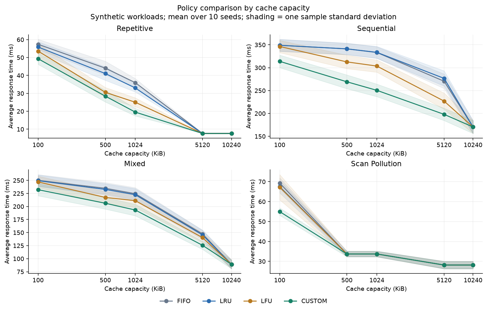
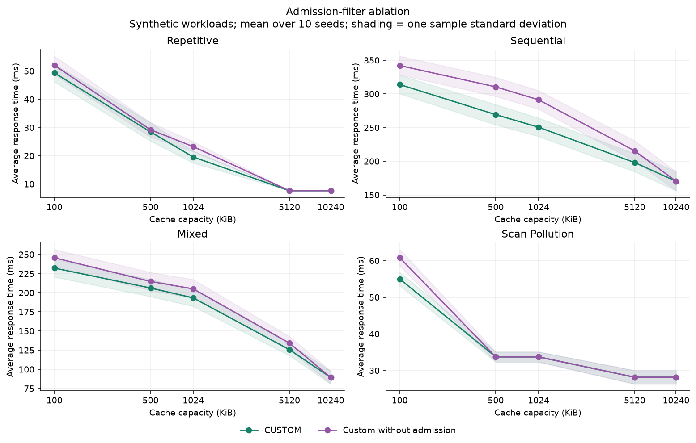

# Reproduced experimental findings

These are draft findings from the integrated simulator's reproduction of D's synthetic experiment matrix. They are inputs to team analysis, not a final report or claims about real browsing traffic. All figures show generated workloads with seeds 0-9. Ratios in the underlying CSV use 0-1; displayed percentages below multiply by 100.

## Reference trace

| Policy | Hits / 15 | Average response ms | Origin traffic KiB |
|---|---:|---:|---:|
| FIFO | 3 | 95.33 | 412 |
| LRU | 3 | 92.33 | 394 |
| LFU | 4 | 84.33 | 362 |
| Custom | 7 | 68.67 | 292 |

The standard-policy results match instructor fixtures; Custom matches D's regression result. This short trace alone cannot establish general superiority.

## Mixed workload: lower response time can increase traffic

At 5 MiB, averaged across ten seeds:

| Metric | LRU | Custom |
|---|---:|---:|
| Hit ratio | 69.40% | 86.22% |
| Average response ms | 145.48 | 125.60 |
| Byte-hit ratio | 9.30% | 8.39% |
| Origin traffic MiB | 3102.537 | 3133.003 |
| Media-client average response ms | 296.88 | 327.28 |
| Repetitive-client average response ms | 28.82 | 7.31 |
| Unpredictable-client average response ms | 239.51 | 188.47 |

Custom improves overall response time and request hit ratio while increasing origin traffic and worsening media-client response time. Its size-normalized savings score prefers small, frequently requested objects, so its global gains do not imply byte efficiency or fairness.

## Workload and objective sensitivity

At 1 MiB on Mixed, LRU averages 222.5542 ms and Custom 193.2267 ms. On Repetitive at 100 KiB, Custom's higher hit ratio (0.6820 versus LRU's 0.6633) and lower latency (49.3242 versus 55.8600 ms) accompany worse byte-hit ratio (0.2412 versus 0.2766) and more origin traffic (32.353 versus 30.844 MiB). Metrics must be interpreted together.

Capacity changes which objects fit and whether replacement matters. The capacity figure reports each workload separately rather than treating one capacity's ranking as universal. Shading is one sample standard deviation across the ten seeds, not a confidence interval.

## Admission ablation

CUSTOM_NOADM removes only the admission filter while retaining lifetime frequencies, saved-latency scores, and inflation. Comparing it against Custom helps separate admission effects from scoring effects. It is an additional variant, not one of the three required standard policies.

## Limits and next review

The four workloads were created by D using the supplied 21-resource catalog. Each seed is replayed identically for every policy and capacity. These are unweighted arithmetic means over ten seeded runs; the batch outputs also preserve per-seed values and sample standard deviations. No train/test tuning claim, real-traffic claim, or guarantee of fairness is made. E should review the final workload choice and interpretation; D should align final pseudocode with the documented executable behavior before the report is finalized.
