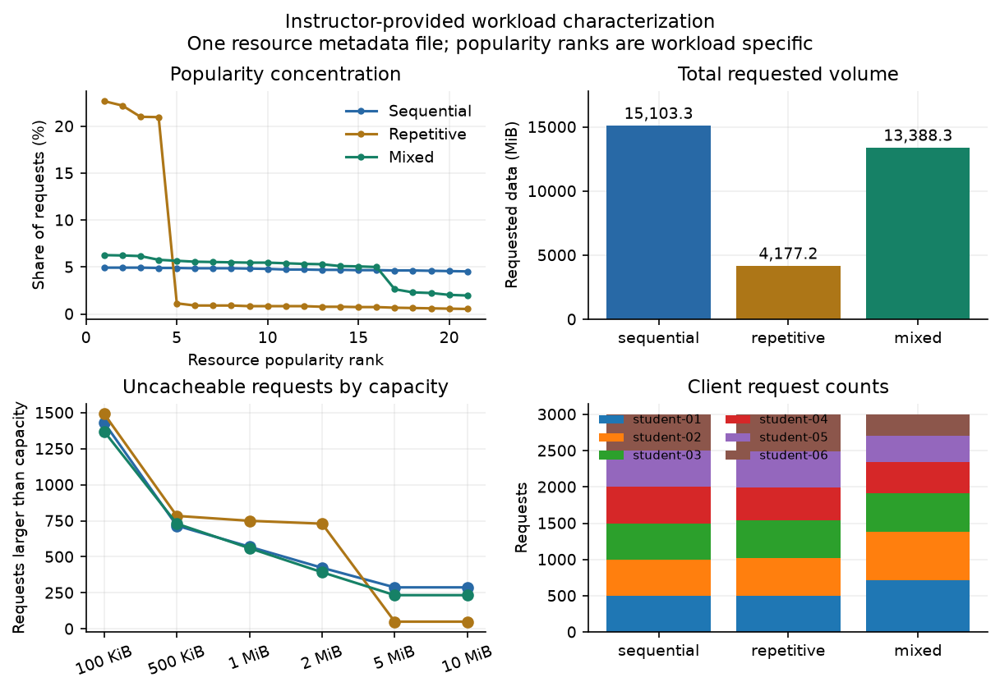
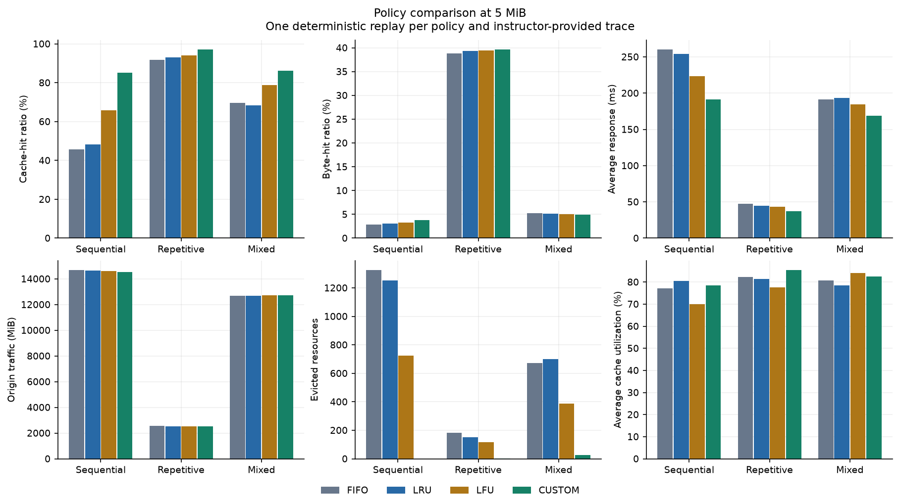
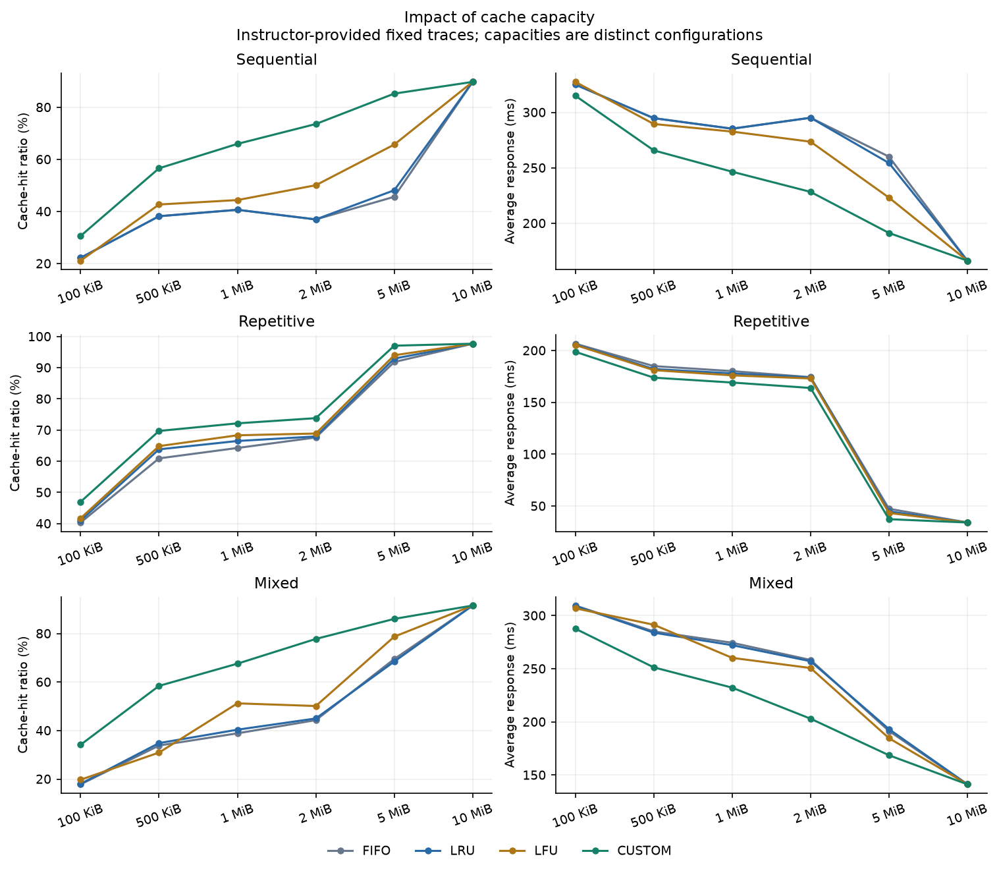
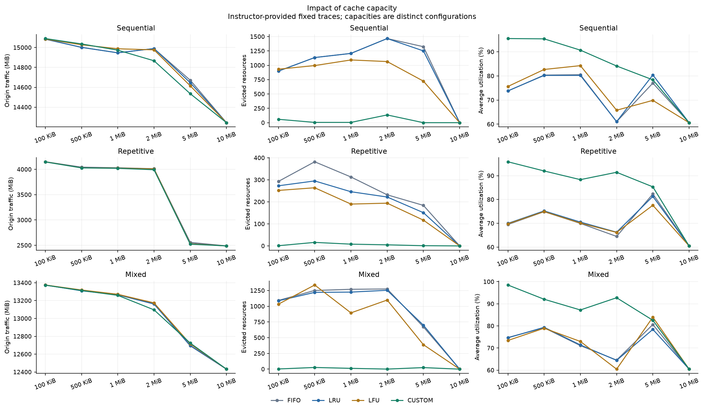
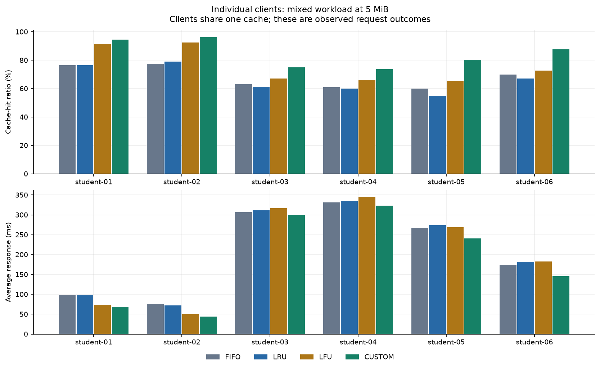

# Findings from the instructor-provided traces

These maintainer run notes summarize the [72-run fixed-trace snapshot](../results/experiments/provided_20261125/) and its generated figures. They are supporting material for contributor review. E remains responsible for the team's interpretation, figure selection and report analysis/conclusions. The integrated four-page report and presentation drafts remain private until the contributor materials are collected and integrated. The [test report](test_report_20261125.md) records program verification; the older [synthetic findings](experimental_findings.md) remain supplementary.

## Inputs and experiment design

Each trace has 3,000 requests, 21 distinct resources and six clients. The top five resources account for 24.60% of sequential requests, 87.97% of repetitive requests and 30.10% of mixed requests. Requested volumes are 15,103.27 MiB, 4,177.20 MiB and 13,388.31 MiB, respectively. Resource identities and top-five counts are preserved in [characterization CSVs](../results/experiments/provided_20261125/characterization/).

The six capacities are 102400, 512000, 1048576, 2097152, 5242880 and 10485760 bytes. The assignment requires six configurations and a 5 MiB comparison; 2 MiB is the team's additional selection. Each of the three fixed traces is replayed once under FIFO, LRU, LFU and CUSTOM at every capacity, with a fresh empty shared cache and 5 ms hit latency. There are no seeds or stochastic confidence intervals for these deterministic runs. Input-only [hypotheses](../results/experiments/provided_20261125/characterization/hypotheses.md) are written before simulations within the batch invocation, without claiming preregistration.

## Policy comparison at 5 MiB

| Workload | Custom hit ratio | Custom mean response | Best standard-policy mean response |
|---|---:|---:|---:|
| Sequential | 85.27% | 191.305 ms | LFU: 223.162 ms |
| Repetitive | 97.07% | 37.375 ms | LFU: 43.353 ms |
| Mixed | 86.07% | 168.633 ms | LFU: 184.695 ms |

Custom has the best request-hit ratio and mean latency on all three traces at this capacity. The mixed traffic winner is FIFO: 13,309,772,800 origin bytes versus Custom's 13,342,135,296. Custom is 8.70% faster than LFU by mean response, but transfers 32,362,496 more bytes than FIFO, or 0.243%. Its mixed byte-hit ratio is 4.96%, below FIFO's 5.19%. Resource-size-normalized latency savings and absolute byte savings favor different retained objects.

At 5 MiB, oversized resources account for 94.27% of sequential requested bytes, 59.42% of repetitive bytes and 92.81% of mixed bytes. This limits byte savings even when request-hit ratio is high. The oversized request counts are 288, 50 and 234; they are identical across policies for a fixed trace and capacity.

Custom evicts 0, 1 and 25 individual resources on sequential, repetitive and mixed. Standard-policy counts are substantially higher, but low eviction count is not a standalone objective: admission bypass can preserve resident objects without caching each fitting miss. Utilization likewise describes occupied capacity rather than proving better performance.

## Capacity changes

Repetitive has 680 requests for the 2,263,040-byte lecture08.pdf. It cannot fit at 2 MiB but fits at 5 MiB, helping explain the sharp improvement at that boundary. Custom's repetitive latency falls from 163.927 ms to 37.375 ms.

At 10 MiB, all four policies have identical results within each workload. The 19 fitting resources total 6,390,784 bytes and coexist without eviction. Two videos remain oversized, so misses and origin traffic do not vanish.

Increasing capacity does not improve every metric at every step. On sequential, FIFO and LRU worsen from 285.317 ms at 1 MiB to 295.182 ms at 2 MiB, with hit ratio falling from 40.67% to 36.97%. A 1,884,160-byte PDF becomes eligible, changing replacement pressure. Mixed LFU also loses some request hits from 1 MiB to 2 MiB while improving latency and traffic. The same request-hit count does not summarize the cost of all misses.

## Client outcomes

At mixed 5 MiB, all six clients have lower mean latency under Custom than under any standard policy. Their reductions relative to their own best standard-policy latency range from 2.46% to 16.74%. Benefits are unequal, and absolute latency differences remain. Five clients transfer more origin bytes than under their own best traffic baseline, while student-06 also improves bytes. These are observed outcomes, not a fairness guarantee or evidence of a harmed latency client in this trace.

## Reproduction and limitations

See [HOWTO](../HOWTO.md) for the batch, plotting, reference validation and independent metric checks. Full-precision [global](../results/experiments/provided_20261125/runs.csv) and [per-client](../results/experiments/provided_20261125/per_client.csv) values, exact input/source hashes and the selected capacities are included. Ratios in CSV are 0-1; figures display percentages. The simulator's existing replacement algorithms were preserved.

These results describe the three supplied fixed traces with fixed origin latencies. They do not test concurrent connections, changing content, bandwidth contention or cache expiration. Generalization beyond these traces requires further experiments. Team review and the all-member presentation remain separate handoffs.
